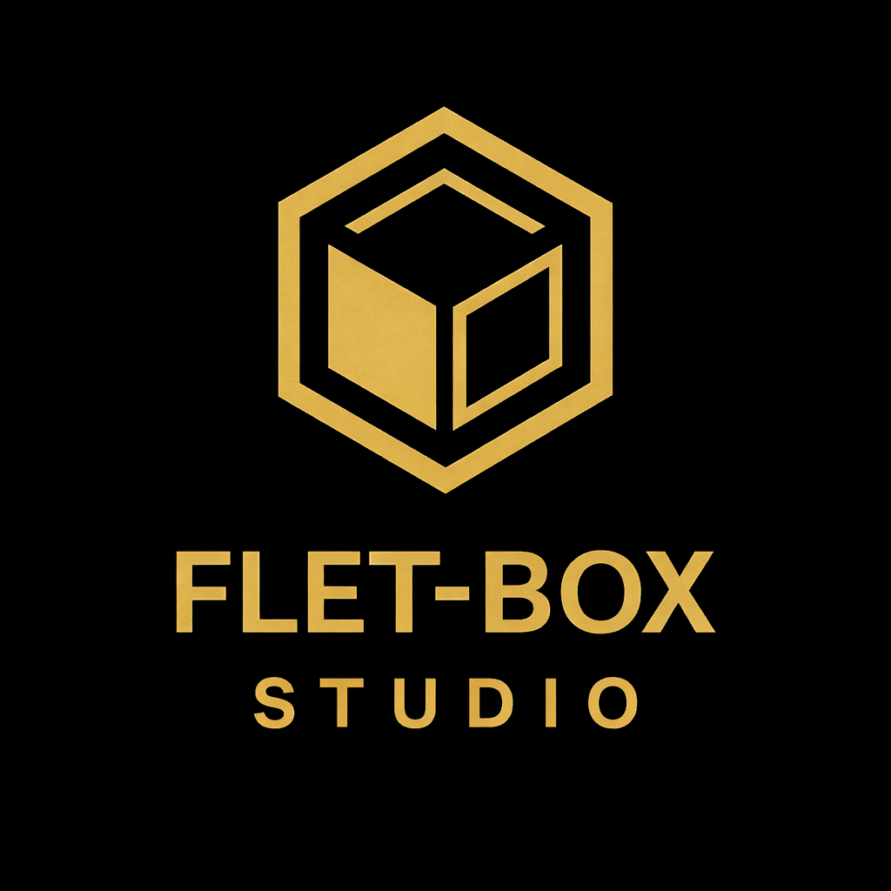

<div align="center">



<h1>FletBox</h1>

<b>Ship web, PWA, Android &amp; iOS from one codebase — with zero runtime dependencies.</b><br>
A declarative, Flutter/Flet-like UI framework in plain vanilla JavaScript.<br>
Real DOM · No Virtual DOM · No build config to learn.

<br>

<a href="https://github.com/sponsors/kuko53348"></a>
<a href="https://www.youtube.com/@flet-box"></a>

<br><br>

<a href="https://github.com/kuko53348/flet-box/blob/HEAD/LICENSE"></a>


<a href="https://github.com/kuko53348/flet-box"></a>

<br><br>

<a href="https://kuko53348.github.io/flet-box-docs/">📖 Docs</a> •
<a href="https://kuko53348.github.io/flet-box-widgets-exemples/">🧪 Widget gallery</a> •
<a href="#quick-start">Quick start</a> •
<a href="https://www.youtube.com/@flet-box">▶ YouTube</a> •
<a href="#support--sponsorship">❤️ Sponsor</a>

</div>

---

**Stop paying the framework tax.** FletBox has no runtime dependencies, no Virtual DOM, and nothing to install beyond Node. Write widgets in the syntax you already know — plain JavaScript — and deploy to browser, PWA, Android, and iOS from the same source.

> ▶ **Learn it on YouTube:** [@flet-box](https://www.youtube.com/@flet-box) — tutorials, walkthroughs, and new widgets.

## Installation

FletBox is on npm, and it drags nothing in with it — `"dependencies": {}`:

```bash
npm install -g flet-box           # the CLI, once (Node >= 20.9)

flet-box create appName           # scaffold your first app
cd appName
npm install                       # pulls flet-box itself from the registry
flet-box run                      # dev server with hot reload
```

Nothing to install at all: `npx flet-box create appName` runs the same scaffolder
straight from the registry, and the project it writes declares `flet-box` as a
normal dependency.

Cloning the repository and `npm link`ing it is still how you *develop the framework
itself* — see [CONTRIBUTING](docs/CONTRIBUTING.md).

## Quick start

```javascript
import { runApp, Container, Text, Button, useState } from "flet-box";

const App = () => {
  const [count, setCount] = useState("count", 0);

  return Container({
    width: "100%",
    minHeight: "100vh",
    display: "flex",
    justifyContent: "center",
    alignItems: "center",
    child: [
      Text({ text: `Counter: ${count}`, fontSize: 24, fontWeight: 700 }),
      Button({ text: "Increment", onClick: () => setCount((v) => v + 1) }),
    ],
  });
};

runApp(App);
```

## Features

- Declarative, widget-based UI · reactive state with `useState` · router for SPAs
- Zero runtime dependencies; ESM only, Node >= 20.9 · real DOM, no Virtual DOM
- Local storage, HTTP services, theme, PWA, and production builds
- Android & iOS from the CLI (APK, simulator `.app`, `.xcarchive`)
- Utility API for layout, text, color, animation, and more

## Commands

```bash
npm run dev        # dev server on port 8000
npm run build      # production bundle with esbuild

# inside a generated project
flet-box createBundle www      # bundle the app into www/
flet-box build android         # Android debug APK
flet-box build ios             # iOS Simulator app (macOS + Xcode)
flet-box build ios --archive   # unsigned iOS archive, sign in Xcode

# API lookup + anti-hallucination gate (works offline, in the repo or any app)
flet-box check-api                      # scan src/ for invented widgets/props
flet-box check-api --props Button       # print the real props of one widget
flet-box check-api --list               # print every public export
flet-box check-api --emit-api           # (re)generate .fletbox/api/cheatsheet.md

# Read one widget from every surface at once (offline)
flet-box unpack Text                    # each prop, where it goes, and what is dead
flet-box unpack Text --example          # a paste-ready call, built only from verified props
flet-box unpack Modal --diff            # where types, engine, docs and code disagree
flet-box unpack --all --md              # every widget, as .fletbox/api/api.json + api.md

# Repair (writes files; run `npm run check` afterwards to confirm)
flet-box audit-fix                      # fix imports and prop typos in one pass
flet-box audit-fix --only imports       # just the import wiring
flet-box audit-fix --only props         # just `chilldren` → `children`
```

In a generated app these are also `npm run check` (and `npm run check -- --props Button`),
because `flet-box create` writes `scripts/check-app.mjs` plus the `AGENTS.md` contract
that points any AI assistant at the real API. `npm run fix` runs `audit-fix`.

`audit-fix` only rewrites a name when exactly one real name is close enough to be
certain — a wrong "fix" that happens to be a valid prop changes the UI silently and
silences the gate, which is worse than the error it replaced. Anything ambiguous is
printed under *Left for you to decide* and the file is not touched.

`flet-box unpack` answers the question the types alone cannot: a prop can be declared,
documented and still reach nothing. It cross-checks the four places a prop lives —
`src/index.d.ts`, the `ALL_PROPS` translation table, the widget's own source, its doc
page — and labels each disagreement: **DEAD** (typed, read by nothing), **INVENTED**
(read by the widget, declared nowhere), **UNDOCUMENTED** (the engine routes it, the
interface hides it), **DOC-ONLY** and **CODE-ONLY** (the page and the code each promise
something the other never heard of). `--example` uses only that verified set, so what it
prints is the whole API you can safely paste; `unpack --all --json` writes the same facts
as `.fletbox/api/api.json` for the AI agent inside an app, which is the surface it should
invent against.

## Android and iOS

`flet-box create` ships the Capacitor config, so the same SPA builds for both platforms. The generated project already declares `flet-box` as a dependency, so one install covers everything:

```bash
flet-box create my-app && cd my-app
npm install                    # flet-box from the registry, plus the Capacitor toolchain
```

- **Android** — Node >= 20.9, a JDK, and the Android SDK. `flet-box build android` → debug APK; `flet-box build android --release [--aab]` → unsigned release artifact to sign yourself (`apksigner` / Play App Signing).
- **iOS** — macOS, the **full** Xcode app (not Command Line Tools), a simulator runtime, and CocoaPods. `flet-box build ios` → simulator; `flet-box build ios --archive` → sign in Xcode.
- Drop a 1024×1024 icon at `assets/logo.png` and rebuild — launcher icons, launch images, and the launch screen regenerate automatically.
- Capacitor serves from `https://localhost`, so a remote API must allow that origin in CORS.

Full guide, including manual `npx cap` workflows: [Mobile and platforms](docs/guides/mobile-and-platforms.md).

## Documentation

Read the docs online: **[The FletBox Book — kuko53348.github.io/flet-box-docs](https://kuko53348.github.io/flet-box-docs/)**.

They are **one continuous book** — the cover maps every page: [The FletBox Book source](docs/README.md).

Rather than read, click: **[the live widget gallery](https://kuko53348.github.io/flet-box-widgets-exemples/)** gives every widget its own page, renders each example in the browser it was written for, and prints the exact call underneath it. The theme toggle in the corner shows the same screen in light and dark, which is the honest way to judge a default color.

And the book itself is an app: **[`flet-box-docs`](https://www.npmjs.com/package/flet-box-docs)** (`npm install flet-box-docs`) renders these same pages with the framework's own `Markdown` widget, with an index, a theme toggle, an offline cache and Android/iOS wrappers.

- [Your first app](docs/guides/first-app.md) — build a working todo app in 20 minutes
- [The widget book](docs/widget/README.md) — every widget with property tables and examples
- [State, Router & Services](docs/guides/state.md) — shared state, routing, storage, and HTTP
- [Tools & Utilities](docs/tools/README.md) — every helper function with signatures
- [The CLI](docs/cli/README.md) — create, run, and build projects
- [FletBox Server](docs/server/README.md) — backend toolkit: API, auth, security, data services
- [SQLite and the API server](docs/server/data-services.md) — where your data lives + a full SQLite API example
- [Mobile and platforms](docs/guides/mobile-and-platforms.md) — Android, iOS, PWA, and desktop
- [Architecture](docs/arquitectura.md) — the widget contract and the single rendering engine
- [Contributing](docs/CONTRIBUTING.md) — how to add code and docs

## Support & sponsorship

<div align="center">

<a href="https://github.com/sponsors/kuko53348">
  
</a>

<br><br>

**FletBox is MIT-licensed and free forever — for individuals and companies alike.**

Zero dependencies. One developer. No corporate budget. Sponsoring is what keeps
it independent — and what turns "nights and weekends" into a framework you can
build a business on.

### ► [Sponsor FletBox on GitHub](https://github.com/sponsors/kuko53348) ◄

</div>

| 💎 Sponsor tier | What you get |
|---|---|
| ☕ **$3 / mo** — Coffee | My thanks + the good karma of keeping open source free |
| 🚀 **$10 / mo** — Supporter | Shout-out in the Sponsors wall + priority on issue replies |
| 🏢 **$50 / mo** — Backer | Your name/logo in this README & docs + feature-request voting |
| 🤝 **Custom** — Partner | Logo + link, priority support, and a say in the roadmap — [email me](mailto:kuko53348@gmail.com) |

Your sponsorship funds **new widgets, the full docs book, test coverage, the mobile toolchain, and the time to ship it all.** One-time contributions welcome on the [sponsorship page](https://github.com/sponsors/kuko53348).

### Other ways to support

- 💳 **Crypto** (Polygon / MATIC-POL): `0x6d437bB66af8d2c44670eA18F059BE1417Dcd7bA`
- 💼 **Commercial support, consulting, or priority help:** [kuko53348@gmail.com](mailto:kuko53348@gmail.com)
- ▶ **Subscribe on YouTube:** [@flet-box](https://www.youtube.com/@flet-box)
- ⭐ **Star the repo** and tell a colleague — visibility is free and it helps enormously

<sub>Living in Cuba makes platforms like Mastercard hard to access, so crypto support is especially valuable. Every contribution — a sponsor tier, a donation, a star, or spreading the word — keeps FletBox growing. Thank you. 🙏</sub>

### ❤️ Our sponsors

<!-- Add sponsor logos/links here as they come in. Example:
<a href="https://github.com/their-username"></a>
-->

<div align="center">

_This space is empty — **be the first!**_

<a href="https://github.com/sponsors/kuko53348">
  
</a>

</div>

## License

MIT — free to use, modify, redistribute, and build commercial products with.
See [LICENSE](LICENSE). Copyright (c) 2026 Maenys Javier Quesada Reyes.
